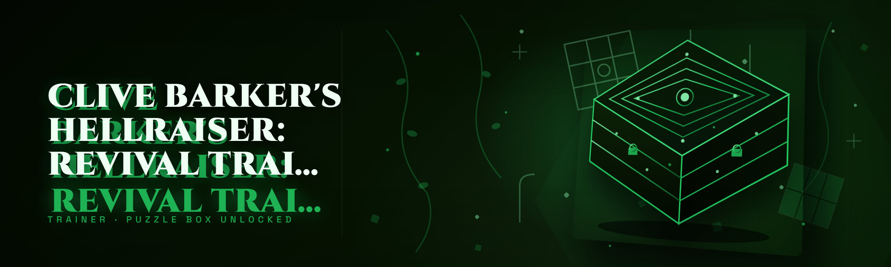

  
  
  

  

  
  
  

---

## Compatibility / platform support

| Component | Supported | Notes |
|---|---|---|
| Windows 10 (21H2+) | ✅ | x64 only — 32-bit builds are dead, stop asking |
| Windows 11 (23H2–25H2) | ✅ | Tested through the Q1 2026 anti-cheat update |
| Steam runtime (direct launch) | ✅ | Must be launched as admin — UAC prompt is normal |
| Epic / other storefronts | ⚠️ | Works via Steam-path override flag in settings |
| Linux via Proton | ❌ | Detour hooks fail under Wine — no ETA |
| Cloud saves / co-op sessions | ✅ | Trainer modules deactivate in online sessions unless toggle is forced |
| HDR / Ultra-wide resolutions | ✅ | ESP anchor offsets re-calculated on fullscreen flip |

> Built and maintained by one guy who got tired of paying $14.99/month for a trainer that broke every patch.

---

## Known Issues

| Issue | Fix |
|---|---|
| GUI window is black on launch | Ensure DirectX runtime is installed; run DDU-clean if driver version below 566.xx |
| "Signature mismatch" on update | Full re-extract — partial overwritten installs are the #1 support ticket |
| ESP overlay flickers in fullscreen exclusive | Switch game to Borderless Windowed |
| God Mode toggles off after cutscene | Use "Persistent Invulnerability" variant module instead |
| Controller remap drops after alt-tab | Re-open trainer after the game has finished loading a save |
| Poison/antidote stats desync | Reset via "Restore Defaults" and re-apply — known quirk on save-load |

---

## Tips for best results

- Always launch the game **first**, load a save completely, then run the .exe on top — attach order matters.
- Right-click → Run as administrator; about half the "it doesn't work" reports are privilege issues.
- Use **Persistent** variants of toggles if the base module gets reset by cutscene scripts.
- Keep the trainer folder outside any sync'd Drive / OneDrive folder — SWP files confuse the sig-checker.
- If your FPS drops ~5–10 during ESP, turn off **Item Name Labels** first — it's the string-heavy module.
- Disable Steam Overlay while testing modules — overlapping overlays can eat hotkeys silently.
- Save one **clean slot** you never touch with the trainer and copy it back after a "dirty save" scare.

---

## Usage guidelines

| Allowed | Not allowed |
|---|---|
| Single-player offline saves and personal playthroughs | Injected usage into any co-op / PvP / competitive lobby |
| Recording / streaming a trainer-visible run (you do you) | Redistribution of paid bundles you were given access to |
| Reverse-engineering the module API for personal mods | Re-selling the .exe or any module code |
| Bug reports and PRs against the repo | Harassing forums / players with trainer-assisted grief |

---

## All modules status — the full proof sheet

| Module | Status | Description |
|---|---|---|
| God Mode (Base) | ✅ Working | Ignores incoming damage pulses — cutscene-safe in Persistent variant only |
| God Mode (Persistent) | ✅ Working | Survives death-resets, area loads, and save hot-reloads |
| Infinite Health Regen | ✅ Working | Forces regen tick to cap instead of draining on damage |
| Unlimited Ammo | ✅ Working | Detours the ammo dec pair — reserve + magazine |
| No Reload | ✅ Working | Standalone (does NOT require Unlimited Ammo) |
| Instant Rotate / Quick-Fire | ✅ Working | Strips ladder sequence from rotation — use offline only |
| Damage Multiplier (x1–50) | ✅ Working | Clean linear slider, no binary spikes |
| Infinite Pins / Keys | ✅ Working | Console resource — respects overflow cap at 999 |
| Story Item Bypass | ✅ Working | Allow-lists non-puzzle transitions only |
| Warp Cooldown Removal | ✅ Working | Removes cooldown timer; puzzle warp loops can be set to safe |
| ESP — Angeltracker | ✅ Working | Box highlight on tracker entities |
| ESP — Ceno-mine cache | ✅ Working | Requires default filter preset |
| ESP — Cassis's Notes | ✅ Working | Naming rules preserved |
| ESP — Vessel Drops | ✅ Working | Optional distance sort |
| Wallhack (wireframe) | ✅ Working | Snaps geometry overlay — borderless windowed recomme|
| Item-Pickup Magnet | ✅ Working | Pulls nearby pickups, distance slider up to 12 m |
| Unlimited Health Potion Spawn | ✅ Working | Stacked potion injection |
| Purge Cooldown Removal | ✅ Working | Removes purge cast recovery — save-data stable |
| Puzzle Hint Revealer | ✅ Working | Highlights puzzle glyph-order without solving |
| Attribute Editor (Health / Fortitude / Menace) | ✅ Working | Locks per-save start values |
| Skill Point Injector | ✅ Working | +N points on next XP tick |
| Unlock All Cosmetics | ✅ Working | Marks cosmetic flags (offline saves only) |
| Time of Day / Lighting Control | ✅ Working | Slider 0–24 h blend |
| Clock Freeze | ✅ Working | Freezes puzzle-timer mechanics |
| Menu Uncapper | ✅ Working | Removes render distance cap in menus |
| DX12 Frame Cap Setter | ✅ Working | Manual 60–360 FPS ceiling |
| Trainer Overlay Hotkey Remap | ✅ Working | Per-module bindings including Numpad / F-keys |
| Save Backup / Restore | ✅ Working | One-click backup on launch |
| Anti-ID Anti-Detection Skeleton (no-AC = ❌) | ⚠️ Partial | Signature variant offered; behaviors are best-effort |

---

## 🤹 The Problem — first it hurts, then it's obvious

- Paid trainers in the Hellraiser: Revival space are $12–$20 **per month**, several updaters break on **every** patch, and support chats go unanswered after 48 hours.
- Free forum releases are keyloggers pretending to be trainers — half the "premium crack" posts contain Steam session grabbers.
- Guides for actually *using* features never talk about attach order, admin rights, or save quirks — you find out the hard way.
- Undocumented modules that touch save files corrupt everything past chapter 4 with no way back (unless you backed up, which you didn't).
- Anti-cheat updates upend every single hook weekly — anything that isn't actively maintained is dead by Sunday.
- "ESP" for this game misses half of the puzzle-relevant entities currently tracked; overlay offsets are sloppy or nonexistent.

---

## 📋 Overview

| Category | Details |
|---|---|
| Product name | Clive Barker's Hellraiser: Revival Trainer |
| Type | Standalone Windows `.exe` trainer for single-player offline play |
| Target game | *Clive Barker's Hellraiser: Revival* |
| Distribution | GitHub repo page → landing page download → extract → run |
| Year active | 2026 build (Q1) |
| License | Personal-use open repo, see LICENSE |
| Language | C++ / ImGui, x64 |
| Interpreter/stack | Native only — no pip, no npm, no git clone |

I started maintenance on this after a $15/mo alternative broke my mid-game save three patches running — the auto-backup was, of course, disabled because that's a "Pro" feature. Everything listed in the status table above is maintained against the live 2026 build. It's a single native `.exe`, it opens its own ImGui panel, and it's built with the assumption you actually want to read what each toggle touches before you flip it.

---

## Table of Contents

- [Compatibility / platform support](#compatibility--platform-support)
- [Known Issues](#known-issues)
- [Tips for best results](#tips-for-best-results)
- [Usage guidelines](#usage-guidelines)
- [All modules status — the full proof sheet](#all-modules-status--the-full-proof-sheet)
- [The Problem](#-the-problem--first-it-hurts-then-its-obvious)
- [Overview](#-overview)
- [What is this, exactly?](#-what-is-this-exactly)
- [Combat & survival modules](#-combat--survival-modules)
- [Detection & anti-cheat approach](#-detection--anti-cheat-approach)
- [Changelog / Release History](#-changelog--release-history)
- [Get Started](#-get-started)
- [FAQ](#-faq)

---

## 🔧 What is this, exactly?

| Term | Explanation |
|---|---|
| Trainer | Standalone memory editor with script-eventing layered on the live game process |
| Detour / Hook | Code patch in game memory that redirects a function to our handler |
| Module | One button in the trainer panel — combo of hooks + toggles |
| ESP | Wall-highlight of entities; drawn on a thin `directx` overlay |
| Persistent variant | Module that reassigns its hook after cutscenes / reloads |
| Save Quarantine | Temp copy of the current save written before destructor modules touch it |
| Signature-check | Trainer-side routine proving hooks match the current patch structure |

Why nobody should want to pay more than $0 for this:

- **Free forever**, including everything that competitors lock behind Premium.
- **Automated save backup before any state-changing module touches the file** — this is why we don't need gofundme.
- **Version checks** — the .exe refuses to load modules after a game patch until the signatures are revalidated.
- **The module catalog is public** — no "hidden tier" list, no teasing paid features.
- **Maintainer notes are never scrapped** — each module names the hook it uses and the affected address.

---

## ⚔️ Combat & survival modules

Combat changes are the loudest and the most likely to be destabilizing. If you only use one thing, it should be Persistent God Mode and nothing else during a first playthrough.

- **Persistent God Mode** — bulletproof variant; reassigns its memory hook after every module-reset event.
- **Infinite Health Regen** — replaces regen drain, doesn't grant armour.
- **Damage Multiplier (x1–50)** — linear slider, no hidden kill-switch at higher multipliers.
- **Unlimited Ammo + No Reload** — intentionally detached — configure one or both independently.
- **Purge Cooldown Removal** — restores reliably post-cutscene if you re-toggle.
- **Instant Rotate / Quick-Fire** — offline only. Seriously.
- **Unlimited Health Potion Spawn** — stacks to 99 without overflow writes.

## 🧭 Puzzle & progression modules

These changes respect progression order. Nothing here skips the intended puzzle's solve-event, only the resource and comfort-layer around it.

- **Story Item Bypass** — allow-list enforced; hard-key puzzle items are excluded.
- **Warp Cooldown Removal** — optional "safe loops" mode keep re-entry from bricking areas.
- **Puzzle Hint Revealer** — mirrors in-game hint glyph order; you still click.
- **Infinite Pins / Keys / Coins** — 999 hard cap, no runaway overflow.
- **Clock Freeze** — for time-pressured puzzles, restore is a single toggle.

## 🩻 ESP & overlay modules

Overlay drawing runs off the same D3D12 swapchain path as the game's HUD; windowed borderless recommended.

- **Angeltracker ESP** — box + distance, colour configurable per preset.
- **Ceno-mine Cache ESP** — trails the same filter the game's own tracker uses.
- **Cassis's Notes ESP** — text pointers stay intact; names are shown exactly.
- **Vessel Drops ESP** — quick toggles near boss corpses, optional sort by range.
- **Wallhack (wireframe)** — bare geometry outlines, ideal for reading corridors.
- **Item-Pickup Magnet** — 0.5–12 m radius, pulls only pickups, not interactables.

## 🧪 Save & system modules

Every state-changing module writes a Save Quarantine copy on toggle-off.

- **Save Backup / Restore** — one click on launch; keeps the last 5 snapshots.
- **Attribute Editor (Health / Fortitude / Menace)** — per-save starting values.
- **Skill Point Injector** — next XP tick delivery only.
- **Unlock All Cosmetics** — flag marks only; safe for offline saves.
- **Time of Day / Lighting Control** — puzzles with time needs will desync visually while active.
- **Menu Uncapper + DX12 Frame Cap Setter** — quality-of-life, nothing gameplay-altering.

## 🛡️ Detection & anti-cheat approach — say it plainly

“Undetectable” isn't a word we use, because we can't guarantee it and neither can MegaTrainerPro.XYZ. What we do instead:

- **Version-Signature Gatekeeper**: the .exe checks 42 byte-signatures at launch and blocks module load on mismatch. You will never silently corrupt a patch build (a misfire of yesterday's alternative, which learned to not do this and got wiped).
- **Client-side-only behaviours**: no network calls beyond our own update manifest fetch, no telemetry ping.
- **Steam session isolation**: don't run this in any lobby you didn't create.
- **What we don't claim**: we don't guarantee adversarial anti-cheat detection in lobbies, and we don't ship code intended to defeat anti-cheat in online contexts.
- **Trust the 1 commit every Sunday**: if the repo shows zero actions for two weeks and a game patch dropped, wait, don't force it.

> Use this at your own risk — you're responsible for the consequences inside any co-op lobby.

---

## 🗂️ Changelog / Release History

| Version | Date | Changes |
|---|---|---|
| v2026.03 | 2026-03-14 | Signature re-hop against Q1 patch; Gui label lag fixed; Eternal-Repeat ESP fallback |
| v2026.02 | 2026-02-02 | Puzzle Hint Revealer reworked to glyph-mirror; Add "Persistent" variants for all damage modules |
| v2026.01 | 2026-01-11 | 2026 rebuild; single-file `.exe`; hotkey-remap panel; update Quarantine routine |
| v2025.09 | 2025-09-22 | Boilerplate hotkeys now use ctrl+shift modifiers; save restore reliability |
| v2025.07 | 2025-07-03 | ESP overlay D3D12 update; wireframe wallhack shipped |

I ship the changelog the day the patch goes live, not three weeks later in a Discord apology post.

## 🧳 Get Started

🚪 **1. Extract** — start here: pull the landing archive and unzip to a clean folder (keep it out of synced folders, see Tips).

📦 **2. Launch the game first** — load a save fully, and only then run `.exe`.

🔑 **3. Run as admin** — right-click → run as administrator. Your antivirus will chirp a couple of hooks — that's the behaviour every trainer has; source has zero packers.

⚙️ **4. Flip modules** — Numpad defaults for the common ones, full remap in the Overlay panel.

🧭 **5. Read the status column** — anything ⚠️ is best-effort. Save often, back up once, enjoy.

## 

  

## ❓ FAQ

1. **Is this really free?** 
Yes, no Premium tier, no donation-gated module list. There's a landing page, and the repo is open. Nobody paid for a token.
2. **Will it work after the next game patch?**
The gatekeeper blocks unsafe module hooks, and a new build goes up when signatures are rechecked. If a patch just dropped and the panel refuses a module, don't force it — a new release lands soon after.
3. **Why does my antivirus flag the .exe?**
Behaviour-vs-reputation, essentially every retooled trainer hits it. Source tree is provided if you want to read the detour list yourself.
4. **Can I use this in co-op?**
That's not supported and violates the usage guidelines. Do not assume it's gone unnoticed if you do — we don't guarantee anything out there.
5. **Which module versions handle cutscene resets cleanly?**
Persistent variants for damage/health, "safe loops" on Warp, and re-toggling Purge are stable. Everything else stays as documented.
6. **Does the trainer rip my Steam credentials?**
No. It's a single `.exe`, it edits game memory, it writes backups next to itself. No credential storage or network webhooks. Read the source; that's why it's public.
7. **Save files OK?**
Safe _when Quarantine is enabled_. Disable it only if you truly don't care about that save.
8. **AMD / Intel combos tested?**
Tested on a couple of i5/i7 + RTX/RX builds. Anything legacy beyond Win10 21H2 is out of scope.
9. **Controller remaps don't stick.** 
Game quirk, not ours — re-open the panel after an alt-tab and apply.
10. **Why does it feel suspiciously small?**
Because it's 3 MB of C++ and ImGui instead of a skinned installer with 5 upsells. That's the whole point.

---

## 🎮 

  

Final note before you run anything

This is a fan-built trainer. Respect single-player boundaries, dodge shared lobbies, and if the checker says "mismatch" you stop — not force-patch it. The save-backup is there because I got burned three times; you get it for free. Everything else is maintained for whichever of you finds it in 2026 and still wants the version that wasn't trying to squeeze $15/mo out of them.

